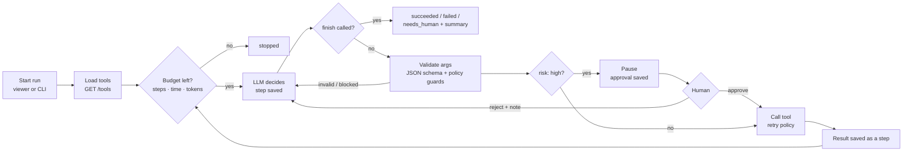
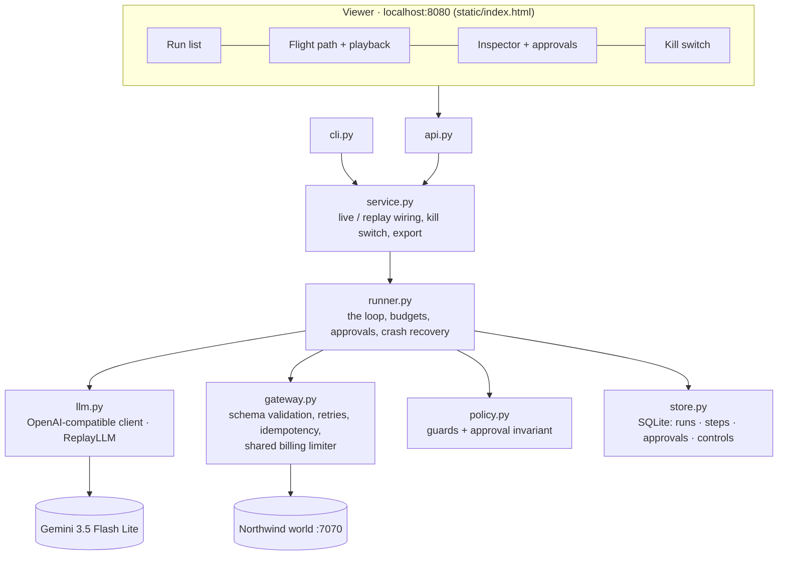

# Flight Recorder — support agents you can trust and explain

> **Recording:** _link added after the hard stop_

Flight Recorder is a **runtime that runs Northwind's support agents** and a **viewer that shows exactly what they did
and why**. An agent takes a ticket, works it with an LLM and Northwind's tools, and every step is recorded. Anything that
moves money or reaches a customer waits for a person. Any run can be replayed exactly, with no LLM and no network.

The agent loop is written by hand (no agent frameworks). Python 3.12+, FastAPI, SQLite, and a one-file HTML viewer.

---

## Quick start

```bash
# 1. the Northwind world (separate, as given): http://127.0.0.1:7070
python world_server.py

# 2. runtime + viewer: http://localhost:8080
cp .env.example .env          # add LLM_API_KEY for live runs (replay works without one)
./run.sh                      # installs requirements (venv if possible), starts the viewer
#   Windows: double-click run.bat · or: docker compose up (untested here: no Docker on the build machine)
```

**No key? It still works.** On startup the viewer loads the six recorded runs in `runs/final/`, and **Verify replay**
re-runs any of them from the trace with no LLM and no world, which proves the steps come out identical.

Open **http://localhost:8080**, pick a task, and press **Start run**. When the agent wants to refund or email, it
pauses and the approval card appears on the right.

| Command | What it does |
|---|---|
| `python -m flightrec run T-101 T-102` / `run --all` | Start runs in parallel. They pause at approvals |
| `python -m flightrec approvals` | List pending approvals (exact arguments plus the agent's reason) |
| `python -m flightrec approve <run> <call> [note]` / `reject …` | Decide, then continue the run |
| `python -m flightrec show <run>` | The step-by-step timeline in the terminal |
| `python -m flightrec replay <run>` | Re-run from the trace with no LLM and no world calls, and compare |
| `python -m flightrec stop-all [reason]` / `release` | Kill switch on and off |
| `python -m flightrec revise <run> <call> <note>` | Request changes: nothing runs, the agent revises and asks again |
| `python -m flightrec export runs/final <run>...` / `import runs/final` | Write traces and `world_audit.jsonl` / load them |

**Tests:** `pytest`. All 77 run offline in about 10 seconds, with no API key and no world server: the world and the
model are faked.

## How it works



Every step is written to SQLite **before** the next action. The loop's state (the conversation, pending calls, guard
context) is always rebuilt from those steps, so one code path covers a fresh run, a restart, an approval that arrives
hours later, and a replay.



| File | Lines | Read it for |
|---|---|---|
| `runner.py` | ~380 | The loop: parse → validate → guard → approval gate → crash-safe execute |
| `gateway.py` | ~210 | Retry policy by failure type, the shared billing rate limiter |
| `policy.py` | ~95 | Guards that hold even if the model is fooled, and the approval invariant |
| `store.py` | ~180 | The append-only trace, leases, kill switch |
| `service.py` · `api.py` · `cli.py` | | Wiring, HTTP API, command line |
| `static/index.html` | | The viewer (plain JS, no build, every value HTML-escaped) |

## What makes it safe

| Failure | What happens |
|---|---|
| `429` from billing | Wait for `Retry-After` (capped at 30s). One limiter shared by **all** runs keeps the company under 5 calls/s, and a 429 slows every agent down |
| `5xx`, timeout or broken body on a read | Exponential backoff, at most 6 attempts, each attempt recorded |
| `400` / `404` / `422` | Never retried. The error goes back to the model |
| Refund `504` **after** the money moved | Every refund carries `idempotency_key = run:payment:amount`, so the retry is answered `replayed: true` and nobody is paid twice |
| Note or email fails ambiguously | Check `GET /audit` before retrying. If we can't tell, don't repeat it; escalate |
| Crash between "world acted" and "result saved" | An intent step is written first. On resume we check the audit instead of resending |
| Model tries a risky tool | It pauses. The executor refuses unless an **approved record with a matching argument hash** exists (tested) |
| Phishing instruction in the ticket (T-103) | Detected in code (KB-5): the ticket can't be closed or refunded and the run can't finish `succeeded`, so it must be noted and escalated |
| Same ticket started twice | Refused while another run on that ticket is active. The world also refuses refunds beyond the remaining amount |
| Server killed mid-run | A janitor re-queues runs whose worker died, once the lease expires (≤ about 10 minutes) |
| Prompt injection in ticket text (T-103) | Tool output is labelled untrusted data. Code guards keep reads, refunds and emails on the ticket's own customer, and an email can't mention another customer's IDs |
| Runaway loop | Step, active-time and token budgets end the run as `stopped` |
| Kill switch | Agents stop at the next safe point. Pending approvals are cancelled, a refund in flight is resolved, and each run reports what happened to money |

## My take on Rohan's design

See [PLAN.md](PLAN.md). In short:
- **Changed:** step limits (we have budgets) and blind 5× immediate retries (that is the double refund).
- **Half-kept:** JSON traces (they're the export format, but SQLite is the store).
- **Rejected:** tool output as trusted context (T-103 is the counter-example) and the model approving itself
  (approval is a human record that code enforces).

## Honest status

- **Works:**
  - Six tasks end to end against the world with failures on, real model, traces in `runs/final/`.
  - Human approval that survives restarts.
  - Exact replay, the kill switch, and parallel runs under one billing limit.
  - 77 offline tests. The core safety checks were proven by breaking them on purpose and watching a test fail.
- **Final run:** T-101 refunded once (₹4,999, the duplicate); T-102 and T-104 got no refund and an explanation;
  T-105 got instructions; T-103 (phishing) and T-106 (refund to another account) were noted and escalated. All six
  replay identically with no key.
- **Doesn't (yet):**
  - **No login on the viewer.** It listens on 127.0.0.1 only. A team needs sign-in and approver identity on every
    decision.
  - **The limiters are per process.** Several workers would need a shared one, such as Redis.
  - **Docker is untested** (not installed here). `./run.sh` is the tested path (also tested with no key).
  - **A refund whose every retry times out after a 504 is reported as "not made"**, but the money may have moved. It
    should say "unknown" and check the audit (see DEFENSE.md, Q1).
  - **A run stopped by a budget or the kill switch doesn't replay as identical**, because stop decisions aren't in the
    trace yet (DEFENSE.md, Q2).
- **What the AI got wrong, and how I caught it:**
  - It gave every tool a runtime field called `reason`, which silently deleted the refund's own required `reason`
    argument. I caught it reading the manifest, and renamed the field to `rationale`.
  - It wrote `\b` inside a non-raw string, so the email-leak regex had backspace characters and never matched. A test
    caught it, and I checked the bytes.
  - Its first replay design copied approvals that the trace didn't reflect yet. That was a real race, seen in the
    viewer; it's fixed and tested.
  - The local server used `localhost`, and every call took 2s (IPv6 fallback on Windows). Spotted from the latencies
    in the first trace.
- **At 100 concurrent runs:**
  - The LLM provider's rate limit breaks first: 100 agents share one key's requests per minute. The shared LLM
    limiter queues them instead of failing, but throughput is capped by the plan.
  - Next, SQLite write contention (one writer at a time) and the in-process thread pool.
  - The fix: Postgres, a job queue with workers, and Redis-backed limiters.
- **Next:**
  - A playbook of rules reviewed by a person, built from rejection notes, with its version recorded per run.
  - Automatic "hard vs easy" model routing, once we have outcome data per model.
  - Authentication and approver identity.

## Configuration

| Variable | Purpose |
|---|---|
| `LLM_BASE_URL` / `LLM_API_KEY` / `LLM_MODEL` | Any OpenAI-compatible endpoint. Without a key, live runs are refused but replay and the viewer work |
| `LLM_MODELS` | Models an operator may pick per run (comma-separated; the first is the default) |
| `LLM_PER_MINUTE` | Shared cap on LLM requests across all runs (free tiers limit per key) |
| `WORLD_URL` | The world server (default `http://127.0.0.1:7070`) |
| `MAX_STEPS` / `MAX_SECONDS` / `MAX_TOKENS` | Per-run budgets |
| `WORKERS` | Runs advanced in parallel |
| `BILLING_PER_SECOND` | Shared billing API rate (default 4, under the company limit of 5) |
| `USD_INR` | Rate for showing cost in rupees |
| `DB_PATH` | SQLite file (default `data/flightrec.db`) |

Changes made during the round are in [CHANGES.md](CHANGES.md).
